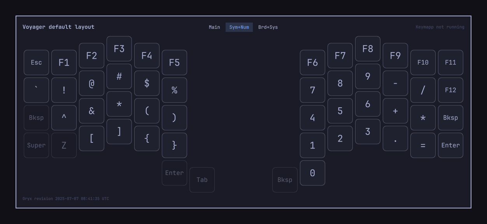
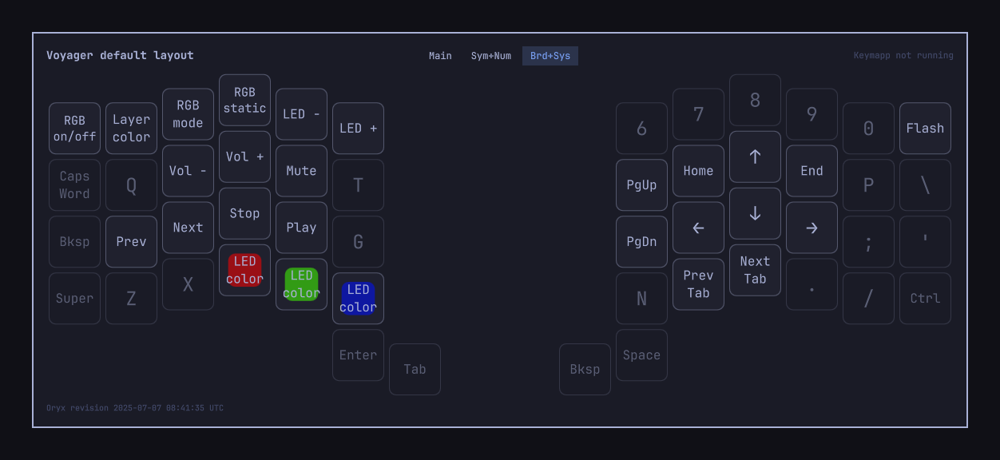
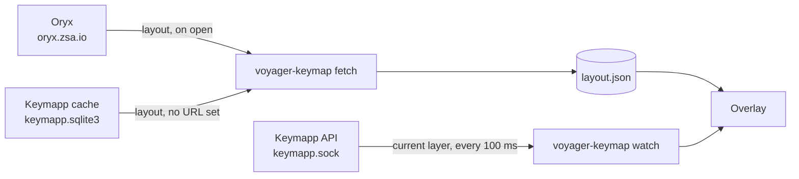

# Voyager Keymap

An on-screen map of your [ZSA Voyager](https://www.zsa.io/voyager) layout for [Omarchy](https://omarchy.org), toggled with one hotkey. It draws every layer from your [Oryx](https://configure.zsa.io) layout and, while Keymapp is running, highlights the layer the keyboard is on as you switch. A community plugin, not part of Omarchy itself.

It is for the weeks after you change your layout, when your fingers haven't caught up yet. The map never takes keyboard focus, so you keep typing while it is up.


| Symbols and numbers | Board and system |
| --- | --- |
|  |  |

Each key shows its tap action in the middle and its hold action underneath. Keys that switch layers are outlined in the theme accent and labeled with the target layer's name. Double-tap actions sit in the top corner, and keys a layer leaves see-through are dimmed, showing the base key that falls through. Colors follow the Omarchy theme.

## Requirements

- Omarchy 4 (the Quattro shell). This is a shell plugin, not a standalone app.
- `python3`, which Omarchy already ships.
- For the live layer only:
  - [Keymapp](https://www.zsa.io/flash) 1.3.2 or newer, running, with its API turned on.
  - [`uv`](https://docs.astral.sh/uv/). The live-layer watcher runs `grpcio` 1.85.1 through `uv run --with`, so nothing is installed into your system Python.

Without Keymapp the map still works. It opens on the first layer, and you click a layer name to switch.

## Install

```bash
omarchy plugin add https://github.com/mark-omarov/omarchy-voyager-keymap.git --enable
```

Then add a hotkey to `~/.config/hypr/bindings.lua`:

```lua
o.bind("SUPER + SHIFT + K", "Voyager keymap", { panel = "io.github.mark-omarov.voyager-keymap" })
```

`omarchy-shell shell toggle io.github.mark-omarov.voyager-keymap` does the same from a terminal or a script. To open on a particular layer, pass it, counting from 0:

```bash
omarchy-shell shell toggle io.github.mark-omarov.voyager-keymap '{"layer": 2}'
```

## Point it at your layout

Open your layout in Oryx and copy its URL. Then add it to the plugin's entry in `~/.config/omarchy/shell.json`:

```json
"plugins": [
  {
    "id": "io.github.mark-omarov.voyager-keymap",
    "layout": "https://configure.zsa.io/voyager/layouts/AbCdE/latest/0"
  }
]
```

The file reloads on save. No login is needed: the plugin reads layouts the way Oryx's share links do.

Without `layout`, the plugin uses the newest Voyager layout in Keymapp's local cache instead. Keymapp downloads the layout that is flashed on your keyboard once the keyboard is connected, so that route needs no URL at all.

## Keeping up with layout changes

Every time the map opens, it re-reads the layout in the background and redraws once the read finishes. Edit in Oryx, open the map, and the change is there.

- `latest` in the URL means the newest saved revision in Oryx, even one you haven't flashed yet, so the map can be ahead of the keyboard until you flash. To pin a revision, put its id from the Oryx URL in place of `latest`.
- The layout id stays the same across revisions, so the URL only changes if you duplicate the layout or start a new one.
- The last successful read is kept in `~/.local/state/voyager-keymap/layout.json`, so the map also works offline.

## Live layer



While the map is open, `voyager-keymap watch` asks Keymapp's [local API](https://github.com/zsa/kontroll) for the keyboard's current layer every 100 ms, and the highlighted tab follows it. The watcher stops when the map closes. To set it up:

1. Install Keymapp and set up USB access by following [ZSA's Linux instructions](https://github.com/zsa/wally/wiki/Linux-install).
2. In Keymapp, open the config page, turn on **API**, and restart Keymapp.
3. Connect the keyboard.

The top-right corner of the map shows the state: `Live: <keyboard>`, `Keymapp: no keyboard`, `Keymapp not running`, or `uv missing: no live layer`.

Keymapp only answers while it is running. [Keymapp Layers](https://github.com/ethanthompson/omarchy-plugin-keymapp) documents a neat way to keep it running on a hidden special workspace, and pairs well with this plugin: it shows the active layer's name in the bar.

## What it touches

- Reads `~/.config/omarchy/shell.json` for its own entry, and `~/.config/.keymapp/` (read-only) when Keymapp is installed.
- Writes only `~/.local/state/voyager-keymap/layout.json`.
- Network: `https://oryx.zsa.io/graphql` when the map opens and `layout` is set. On the first live-layer run, `uv` downloads `grpcio` from PyPI into its cache.
- Needs no root access, runs no background services, and never edits your Hyprland config.

## Remove

```bash
omarchy plugin remove io.github.mark-omarov.voyager-keymap
rm -rf ~/.local/state/voyager-keymap
```

Then delete the hotkey line from `~/.config/hypr/bindings.lua`.

## Notes

- `omarchy plugin disable` followed by `enable` recreates the plugin's entry and drops `layout`; add it back afterwards.
- The plugin stays loaded between opens. After editing its QML, run `omarchy restart shell`.
- Tests: `python3 -m unittest discover -s tests`.

## License

MIT. Not affiliated with ZSA Technology Labs. Voyager, Oryx and Keymapp are ZSA's trademarks.
