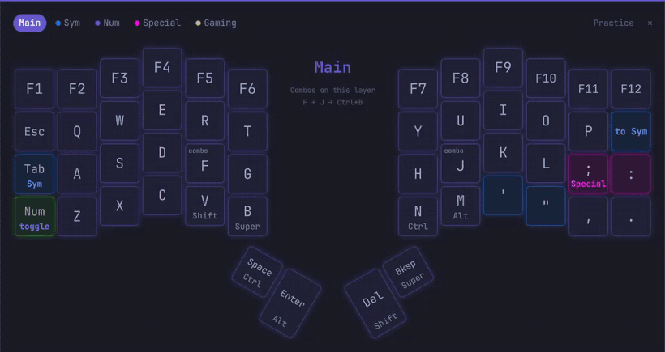

# Voyager Keymap

A live map of your [ZSA Voyager](https://www.zsa.io/voyager) layout for [Omarchy](https://omarchy.org). It follows your layer, lights up the keys you press, and colors each key like its LED, so blank keycaps still match the screen. Practice mode lets you try keys without anything reaching your apps.



## Reading a key

| On the key | Means |
| --- | --- |
| Big label | Tap |
| Small text below | Hold |
| Colored layer name | Switches to that layer: `Sym` on hold, `to Main` on tap, `toggle` on tap |
| `2× ]` | Double tap |
| `tap+hold X` | Tap, then hold |
| `macro` | Types the sequence shown |
| `combo` | Does something else pressed together with another key; the middle lists the combos |
| Glow color | The key's LED color on that layer |
| Faded | Unassigned here, acts as on the base layer |

Point at or press a key and the middle of the map spells out everything it does.

## Install

```bash
omarchy plugin add https://github.com/mark-omarov/omarchy-voyager-keymap.git --enable
```

Hotkeys for `~/.config/hypr/bindings.lua`:

```lua
o.bind("SUPER + SHIFT + K", "Voyager keymap", { panel = "io.github.mark-omarov.voyager-keymap" })
o.bind("SUPER + SHIFT + ALT + K", "Voyager keymap practice", [[omarchy-shell shell summon io.github.mark-omarov.voyager-keymap '{"action":"practice"}']])
o.bind("SUPER + SHIFT + CTRL + K", "Move Voyager keymap", [[omarchy-shell shell summon io.github.mark-omarov.voyager-keymap '{"action":"move"}']])
```

USB access needs ZSA's udev rules from their [Linux guide](https://github.com/zsa/wally/wiki/Linux-install), the same ones Keymapp uses. They open every Voyager device, typing included, to every program; this narrower rule is enough:

```
KERNEL=="hidraw*", ATTRS{idVendor}=="3297", TAG+="uaccess"
SUBSYSTEM=="usb", ATTR{idVendor}=="3297", TAG+="uaccess"
```

Point it at your Oryx layout in `~/.config/omarchy/shell.json`:

```json
{ "id": "io.github.mark-omarov.voyager-keymap", "layout": "https://configure.zsa.io/voyager/layouts/AbCdE/latest/0" }
```

Without `layout` it uses the layout [Keymapp](https://www.zsa.io/flash) last read from the keyboard. The map re-reads the layout on every open; `latest` includes edits not flashed yet.

## Use

| | Keyboard | Mouse |
| --- | --- | --- |
| Show, hide | Super+Shift+K | ✕ |
| Practice | Super+Shift+Alt+K | Practice |
| Move | Super+Shift+Ctrl+K | Drag |
| Resize | | Scroll |
| Other layer | | Click its name |

The map never takes keyboard focus and remembers where you put it.

Practice mode swallows every key from every keyboard before apps and shortcuts see it, while the map keeps reacting. Its hotkey always ends it, even if the shell hangs, and so does closing the map. It is a Hyprland submap created at runtime; no config is edited.

Optional settings in the same `shell.json` entry: `toggleKey`, `practiceKey`, `moveKey`, if you bind other keys than above.

## What it touches

| | |
| --- | --- |
| Reads | Its `shell.json` entry, Keymapp's cache (read-only), the Voyager's raw HID channel while open |
| Writes | `~/.local/state/voyager-keymap/` |
| Network | `oryx.zsa.io` on open, ZSA's keycode list weekly |

Key positions are drawn, never stored. No root access, no background services.

## Remove

```bash
omarchy plugin remove io.github.mark-omarov.voyager-keymap
rm -rf ~/.local/state/voyager-keymap
```

and the hotkey lines in `bindings.lua`.

## Notes

- After `omarchy plugin disable` and `enable`, add `layout` back.
- After editing the QML, run `omarchy restart shell`.
- Tests: `python3 -m unittest discover -s tests`.
- [Keymapp Layers](https://github.com/ethanthompson/omarchy-plugin-keymapp) shows the active layer in the bar.

MIT. Not affiliated with ZSA Technology Labs.
