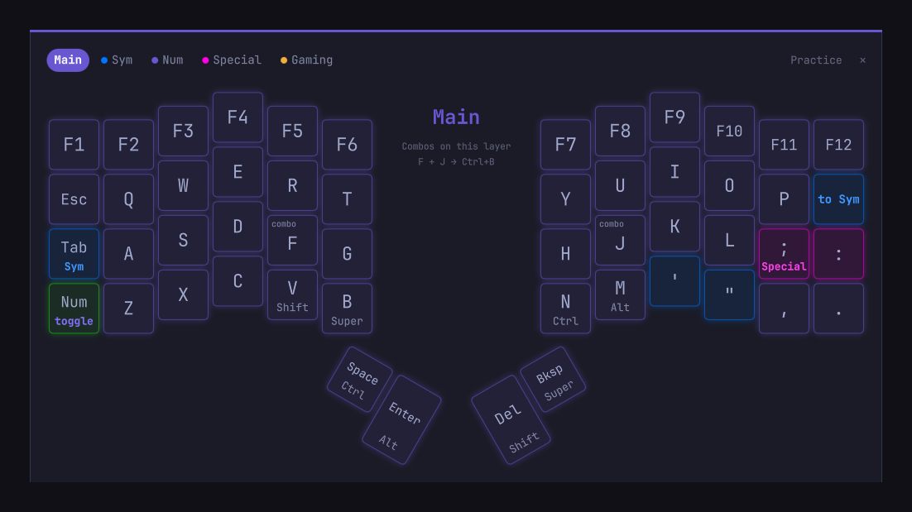
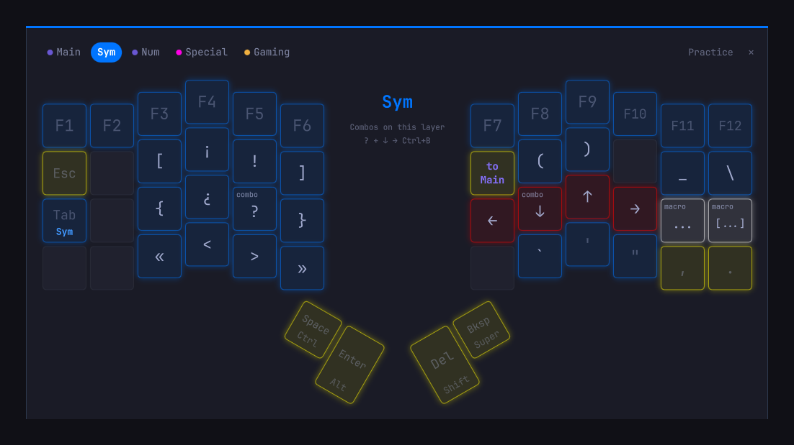
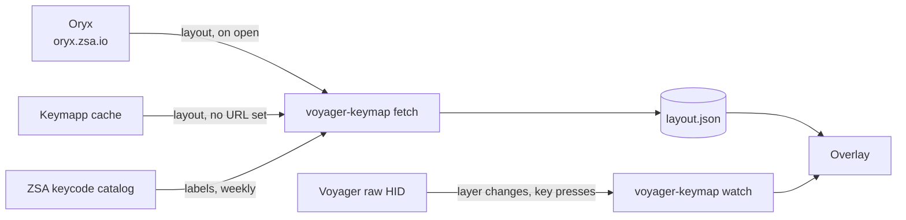

# Voyager Keymap

A live map of your [ZSA Voyager](https://www.zsa.io/voyager) layout for [Omarchy](https://omarchy.org), one hotkey away. It follows the layer you are on, lights up the keys you press, and colors every key the way its LED is lit, so a board with blank keycaps still matches what you see on screen. A practice mode lets you try keys and combos without anything reaching your apps. A community plugin, not part of Omarchy itself.





## Reading the map

- The big label is what a tap does. The small text under it is what holding does.
- Each key glows in the color its LED has on that layer, so you can find it on the board by color.
- Keys that switch layers name the target layer in its color: `Sym` under Tab means hold Tab for Sym, `to Main` switches on a tap, `toggle` turns a layer on and off.
- `2×` in the top corner is what a double tap does, `tap+hold` at the bottom is what a tap followed by a hold does.
- `macro` marks a key that types a sequence; the label shows the sequence.
- `combo` marks keys that do something else when pressed together. The middle of the map lists the combos on the current layer, for example `F + J → Ctrl+B`.
- Faded keys are left unassigned on this layer and act as they do on the base layer. Empty keys do nothing.
- Point at a key, or press it, and the middle of the map spells out everything it does.

The labels come from Oryx: every keycode Oryx offers, macros, one-shot modifiers, all layer key types, combos, custom labels and per-key tapping terms.

## Install

Requires Omarchy 4 and `python3`, which Omarchy ships.

```bash
omarchy plugin add https://github.com/mark-omarov/omarchy-voyager-keymap.git --enable
```

Add the hotkeys to `~/.config/hypr/bindings.lua`:

```lua
o.bind("SUPER + SHIFT + K", "Voyager keymap", { panel = "io.github.mark-omarov.voyager-keymap" })
o.bind("SUPER + SHIFT + ALT + K", "Voyager keymap practice", [[omarchy-shell shell summon io.github.mark-omarov.voyager-keymap '{"action":"practice"}']])
o.bind("SUPER + SHIFT + CTRL + K", "Move Voyager keymap", [[omarchy-shell shell summon io.github.mark-omarov.voyager-keymap '{"action":"move"}']])
```

The map reads the keyboard over USB, which Linux allows only with ZSA's udev rules. Install them as described in [ZSA's Linux guide](https://github.com/zsa/wally/wiki/Linux-install); Keymapp needs the same rules. Their rules open every device the Voyager exposes, its typing devices included, to every program. Only the raw HID channel is needed, so this narrower rule is enough for both the map and Keymapp:

```
KERNEL=="hidraw*", ATTRS{idVendor}=="3297", TAG+="uaccess"
SUBSYSTEM=="usb", ATTR{idVendor}=="3297", TAG+="uaccess"
```

## Point it at your layout

Copy your layout's URL from Oryx and add it to the plugin's entry in `~/.config/omarchy/shell.json`:

```json
{ "id": "io.github.mark-omarov.voyager-keymap", "layout": "https://configure.zsa.io/voyager/layouts/AbCdE/latest/0" }
```

Without `layout`, the map uses the newest Voyager layout in [Keymapp](https://www.zsa.io/flash)'s local cache, which holds the layout flashed on your keyboard once Keymapp has connected to it.

The map re-reads the layout every time it opens, so edits in Oryx show up on the next open. `latest` means the newest saved revision, even one you have not flashed yet; put a revision id in its place to pin one. The layout id stays the same across revisions, so the URL only changes if you start a new layout.

## Use

| | Keyboard | Mouse |
| --- | --- | --- |
| Show or hide | Super+Shift+K | ✕ in the corner |
| Practice on or off | Super+Shift+Alt+K | Practice in the corner |
| Move | Super+Shift+Ctrl+K cycles through the corners and edges | Drag the map |
| Resize | | Scroll over the map |
| Look at another layer | | Click its name |

The map never takes keyboard focus, so you keep typing while it is open. Position and size are remembered.

### Practice mode

Practice mode swallows every key before it reaches an app or a shortcut, while the map keeps lighting up keys, following layers and explaining what you press. It is the way to try combos, macros and complex keys without side effects. It blocks every keyboard, not only the Voyager; the mouse keeps working.

The practice hotkey always ends it, because Hyprland handles that key itself. The show/hide hotkey and closing the map end it too. Practice mode is a temporary Hyprland submap created at runtime; your Hyprland config is not changed.

### Settings

All optional, in the plugin's entry in `~/.config/omarchy/shell.json`:

| Key | Default | |
| --- | --- | --- |
| `layout` | none | Oryx layout URL or id |
| `toggleKey` | `SUPER + SHIFT + K` | Must match your show/hide binding, so it also works in practice mode |
| `practiceKey` | `SUPER + SHIFT + ALT + K` | Ends practice mode |
| `moveKey` | `SUPER + SHIFT + CTRL + K` | Moves the map in practice mode |

## How it works



While the map is open, `voyager-keymap watch` reads the keyboard's raw HID channel. The firmware reports each layer change and each key press as the key's position. When Keymapp is running it has already asked the keyboard for these reports and the map listens alongside; otherwise the map asks for them itself and asks the keyboard to stop when the map closes.

## What it touches

- Reads its own entry in `~/.config/omarchy/shell.json`, Keymapp's cache in `~/.config/.keymapp/` (read-only), and the Voyager's raw HID channel while the map is open. Key positions are only drawn, never stored.
- Writes `~/.local/state/voyager-keymap/`: the last layout, ZSA's keycode labels and the map's position.
- Network: `oryx.zsa.io` each time the map opens with `layout` set, and `configure.zsa.io/metadata.json` (ZSA's keycode labels) at most once a week.
- Needs no root access, runs no background services, and never edits your config.

## Remove

```bash
omarchy plugin remove io.github.mark-omarov.voyager-keymap
rm -rf ~/.local/state/voyager-keymap
```

Then delete the three hotkey lines from `~/.config/hypr/bindings.lua`.

## Notes

- `omarchy plugin disable` followed by `enable` recreates the plugin's entry without `layout`; add it back afterwards.
- The plugin stays loaded between opens. After changing its QML, run `omarchy restart shell`.
- Tests: `python3 -m unittest discover -s tests`.
- [Keymapp Layers](https://github.com/ethanthompson/omarchy-plugin-keymapp) shows the active layer's name in the bar and pairs well with this map.

## License

MIT. Not affiliated with ZSA Technology Labs. Voyager, Oryx and Keymapp are ZSA's trademarks.
